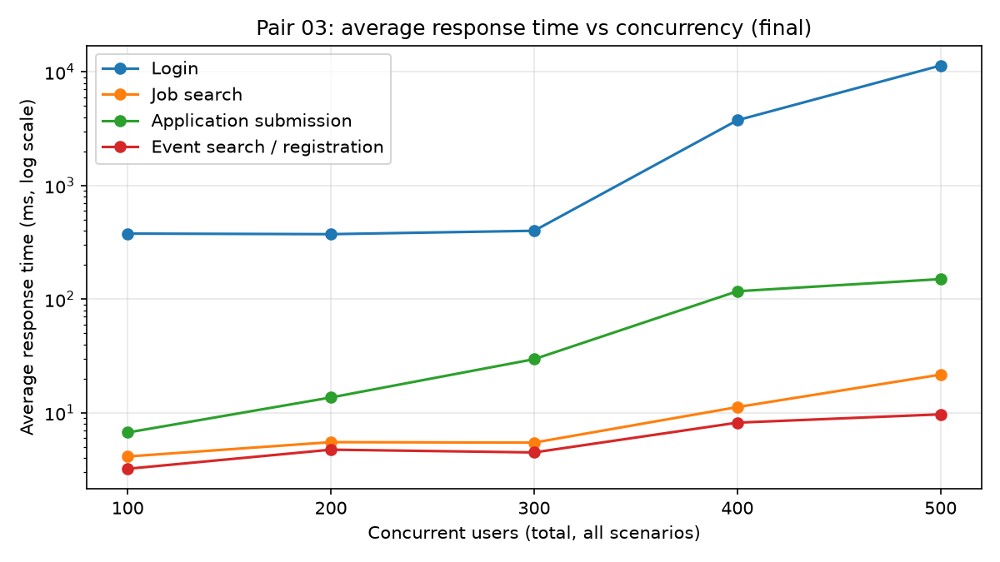

# Lab 1 Metrics

## Measurement Snapshot

| Item | Value |
|---|---|
| Pair | 03 |
| Branch | `integration/final-merge` |
| Commit | `b9e40e62b5247de62297626c9b9959b954195c05` |
| Verification date | 2026-10-19 |
| `PORT_BASE` | 9030 |
| Database prefix | `p03` |
| Seed | 3 |
| City set | San Jose, Santa Clara, Fremont |

## Automated Verification

| Check | Result | Details |
|---|---:|---|
| Backend test suite | PASS | 236 passed, 0 failed, 1 dependency deprecation warning |
| Frontend lint | PASS | ESLint completed with no findings |
| Frontend production build | PASS | 110 modules transformed; build completed in 244 ms |
| FastAPI route decorators | 35 | Counted across `backend/app/routers/` |
| Registered assistant tools | 5 | Preferences, job search, job details, event search, and save |

### Backend Tests by Module

| Test module | Collected tests |
|---|---:|
| `test_ai_core.py` | 35 |
| `test_ai_tools.py` | 73 |
| `test_canonical_schema.py` | 19 |
| `test_company_workflows.py` | 10 |
| `test_final_seed_data.py` | 16 |
| `test_student_applications.py` | 17 |
| `test_student_assistant.py` | 32 |
| `test_student_auth.py` | 7 |
| `test_student_events.py` | 11 |
| `test_student_jobs.py` | 16 |
| **Total** | **236** |

## Deterministic Seed Dataset

The seed generator uses `SEED = 3` and validates these reserved demo-record counts after each successful run.

| Entity | Expected count |
|---|---:|
| Students | 200 |
| Companies | 50 |
| Jobs | 300 |
| Applications | 1,500 |
| Events | 100 |
| Student preference rows | 150 |
| Event registrations | 600 |
| Saved jobs and events | 600 |

The generator is idempotent for its reserved `seed3` records, does not drop or truncate tables, and is covered by 16 automated seed-data tests.

## Assistant Tool-Call Reliability

The agent loop was evaluated across 20 deterministic adversarial turns. Four turns were assigned to each initial outcome category. Failed calls received one error-specific repair prompt; the loop stopped cleanly after the bounded repair attempt.

| Failure mode | Before repair | After repair | Representative example |
|---|---:|---:|---|
| Malformed arguments | 4 | 0 | Invalid JSON repaired to a valid `search_jobs` call |
| Unknown tool name | 4 | 0 | `find_jobs` repaired to registered tool `search_jobs` |
| Text where a tool was required | 4 | 0 | Unsupported text repaired to `search_events` |
| Lost multi-step chain | 4 | 0 | Preferences lookup continued to the required job search |
| Well-formed and correct | 4 | 20 | `is_remote=true` used for a remote internship search |
| **Total turns** | **20** | **20** | One repair attempt maximum |

| Reliability summary | Before repair | After repair |
|---|---:|---:|
| Valid turns | 4 | 20 |
| Failed turns | 16 | 0 |
| Valid-call rate | 20% | 100% |

These are controlled reliability-test results produced with scripted model responses and the real agent loop. They measure the repair behavior deterministically; they are not presented as the natural error rate of the Ollama model.

## Frontend Build Output

| Artifact | Raw size | Gzip size |
|---|---:|---:|
| `dist/index.html` | 0.45 kB | 0.29 kB |
| Main CSS bundle | 54.15 kB | 9.16 kB |
| Main JavaScript bundle | 389.45 kB | 117.41 kB |


## Lab 2 Load Test (JMeter)

Apache JMeter 5.6 (non-GUI), plan `loadtest/handshake.jmx`, run against the Docker Compose stack
on one MacBook Pro (Docker Desktop, 7.7 GiB for containers; JMeter on the same machine, so the
numbers include that contention). Code under test: commit `3d15d3a` on
`feature/lab2-company-services`, `PERSISTENCE=sql`, seed 3 data loaded.

Four scenarios run at the same time: student login + job search, student login + application
upload (PDF), student login + event search + registration, company login + dashboard.
Each virtual user logs in once, then repeats its scenario 30 times with a 500 ms think time.
Users are per scenario, so 25 users per scenario is 100 concurrent users in total.
Applying twice and registering twice are expected 409 answers and count as passes.

| Concurrent users | Requests | Throughput | Mean | p95 | p99 | Max | Errors |
|---:|---:|---:|---:|---:|---:|---:|---:|
| 100 | 6,850 | 105 req/s | 10 ms | 14 ms | 260 ms | 626 ms | 0.00% |
| 300 | 20,550 | 272 req/s | 21 ms | 82 ms | 261 ms | 571 ms | 0.00% |
| 500 | 34,250 | 404 req/s | 264 ms | 968 ms | 1,552 ms | 3,164 ms | 0.00% |

Per request, selected rows (mean / p95 in ms):

| Request | 100 users | 300 users | 500 users |
|---|---:|---:|---:|
| Student login (bcrypt, once per user) | 274 / 340 | 267 / 314 | 308 / 366 |
| Search jobs by keyword | 4 / 7 | 6 / 19 | 118 / 383 |
| Apply with resume (upload) | 8 / 16 | 35 / 138 | 402 / 1,034 |
| Search events | 6 / 9 | 14 / 43 | 250 / 722 |
| Register for event | 5 / 10 | 17 / 63 | 307 / 877 |

### Bottlenecks found and fixed

| Step | Symptom | Cause | Fix |
|---|---|---|---|
| 1 | 300 users: 3% errors, slowest request 31 s | Each service kept the SQLAlchemy default pool (5 + 10 connections); the logs show `QueuePool limit of size 5 overflow 10 reached` | Pool of 20 + 20, 10 s wait, MySQL `max_connections` 500 (commit `19c72b6`) |
| 2 | 500 users: 11.6% errors, 34,250 requests took 10 min 27 s, mean 3.7 s, slowest 89 s | All failures in the Event service (`QueuePool limit of size 20 overflow 20 reached`, 2,132 errors); MySQL was not the limit (132 of 500 connections used at peak) | Thread pool raised from 40 to 120 per service so finished requests can return their connection (commit `3d15d3a`) |
| 3 | 500 users, same plan | None | 34,250 requests in 1 min 25 s, 0 errors (re-run after the Kafka producers were merged; slightly slower than the first clean run, which had 432 req/s and a 180 ms mean) |

Step 2 is explained as FastAPI running plain endpoints and the clean-up of the `get_db`
dependency on one shared 40-thread pool: when all threads wait for a connection, finished
requests cannot get a thread to release theirs. The fix removed the symptom; the explanation
was not isolated with a separate experiment.

### Kubernetes (Docker Desktop, `PERSISTENCE=sql`, same plan and data)

Services were published on localhost with LoadBalancer services (`scripts/k8s_expose.sh`);
`kubectl port-forward` cannot carry this load. One replica of each service.

| Concurrent users | Requests | Throughput | Mean | p95 | p99 | Max | Errors |
|---:|---:|---:|---:|---:|---:|---:|---:|
| 100 | 6,850 | 105 req/s | 11 ms | 15 ms | 349 ms | 718 ms | 0.00% |
| 300 | 20,550 | 272 req/s | 18 ms | 55 ms | 261 ms | 1,159 ms | 0.00% |
| 500 | 34,250 | 372 req/s | 196 ms | 338 ms | 617 ms | 26,567 ms | 0.00% |

No pod restarted and no connection-pool error appeared in any service log. At 500 users the
slow tail is the login burst: all 375 student users log in within the first 30 seconds, and
296 logins took over 5 s (mean 12 s, p95 24 s). Every other request stayed fast (500 users:
keyword search 30 ms mean, apply 102 ms, register 73 ms). On Compose the same login averaged
about 300 ms, because the containers there are not CPU limited.

Problems found on Kubernetes that Docker Compose did not show, and how they were fixed:

| Step | Symptom | Evidence | Fix |
|---|---|---|---|
| 4 | First run: 100 users already slow (mean 176 ms, worst 27 s); 300 users 10.25% errors, 500 users 21.78%; the student pod restarted twice, the company pod failed a probe | Student logs: logins took 18 to 24 s; events: `Liveness probe failed ... context deadline exceeded`, `Container student failed liveness probe, will be restarted` | Pods were capped at 0.5 CPU and `/health` was a plain function that waited for a free worker thread behind the bcrypt logins. `/health` is now `async def` (answers on the event loop), liveness timeout 3 s to 10 s with 6 failures allowed, readiness timeout 5 s, CPU limit 2 per service |
| 5 | After step 4: 100 and 300 users clean, 500 users 2.91% errors (37 student logins returned 500, the other 960 errors are the 401s of users without a token) | Student log: `QueuePool limit of size 20 overflow 20 reached` exactly 37 times; no pod restarted; MySQL peak 163 of 500 connections | A login holds a database connection while bcrypt runs, so the Student service now has a pool of 60 + 60, matching its 120 worker threads (other services keep 20 + 20) |
| 6 | Re-run after step 5 | none | 100, 300 and 500 users: 0 errors, MySQL peak 239 of 500 connections |

Limits of the Kubernetes test: one replica per service, no autoscaling; a slow login burst at
500 users (see above), which more Student replicas or a cheaper password hash would reduce but
which was not tried.

### Part 5: all five concurrency levels (Kubernetes, `PERSISTENCE=sql`, 2026-11-12)

Run with `sh scripts/k8s_loadtest.sh final`; the tables come from `python loadtest/summarize.py crud final`
and the graph is `loadtest/avg_response_final.png`. The plan runs the four scenarios (login + job
search, application submission, event search/registration, company dashboard) at the same time, so
"users" is the total concurrent users across scenarios. Application submission publishes
`application.created` to Kafka and event registration publishes `event.registration_created`.
One replica of every service, 0 pod restarts, no pool error in any log, MySQL peak 239 of 500 connections.

| Concurrent users | Requests | Throughput | Mean | Max | Errors |
|---:|---:|---:|---:|---:|---:|
| 100 | 6,850 | 104 req/s | 10 ms | 773 ms | 0.00% |
| 200 | 13,700 | 193 req/s | 12 ms | 823 ms | 0.00% |
| 300 | 20,550 | 270 req/s | 17 ms | 1,017 ms | 0.00% |
| 400 | 27,400 | 336 req/s | 81 ms | 12,478 ms | 0.00% |
| 500 | 34,250 | 372 req/s | 179 ms | 23,806 ms | 0.00% |

Per endpoint (login is one request per virtual user, so it has the fewest samples):

#### Login

| Users | Requests | Avg (ms) | Throughput (req/s) | Error rate |
|---:|---:|---:|---:|---:|
| 100 | 75 | 378 | 3.8 | 0.00% |
| 200 | 150 | 373 | 6.0 | 0.00% |
| 300 | 225 | 400 | 7.5 | 0.00% |
| 400 | 300 | 3754 | 8.6 | 0.00% |
| 500 | 375 | 11375 | 8.4 | 0.00% |

#### Job search

| Users | Requests | Avg (ms) | Throughput (req/s) | Error rate |
|---:|---:|---:|---:|---:|
| 100 | 1500 | 4 | 23.7 | 0.00% |
| 200 | 3000 | 6 | 43.6 | 0.00% |
| 300 | 4500 | 5 | 61.2 | 0.00% |
| 400 | 6000 | 11 | 76.2 | 0.00% |
| 500 | 7500 | 22 | 84.3 | 0.00% |

#### Application submission

| Users | Requests | Avg (ms) | Throughput (req/s) | Error rate |
|---:|---:|---:|---:|---:|
| 100 | 750 | 7 | 15.5 | 0.00% |
| 200 | 1500 | 14 | 27.8 | 0.00% |
| 300 | 2250 | 30 | 37.8 | 0.00% |
| 400 | 3000 | 117 | 43.8 | 0.00% |
| 500 | 3750 | 150 | 46.5 | 0.00% |

#### Event search / registration

| Users | Requests | Avg (ms) | Throughput (req/s) | Error rate |
|---:|---:|---:|---:|---:|
| 100 | 1500 | 3 | 30.8 | 0.00% |
| 200 | 3000 | 5 | 55.6 | 0.00% |
| 300 | 4500 | 4 | 76.5 | 0.00% |
| 400 | 6000 | 8 | 93.7 | 0.00% |
| 500 | 7500 | 10 | 102.1 | 0.00% |



First bottleneck: the student login. Its mean stays near 375 ms up to 300 users, then rises to
3.8 s at 400 and 11.4 s at 500 while its throughput stays at about 8.5 logins/s. Every login
runs a bcrypt hash on one Student replica, and the 120 worker threads queue behind the CPU, so
the extra users only wait longer (queueing, not errors). Application submission is second: its
mean grows from 7 ms to 150 ms and its throughput flattens at about 44 to 46 req/s from 400
users on; each request uploads a PDF, writes to MySQL and publishes to Kafka (this cause was
not profiled separately). Job search and event search/registration stay at 22 ms or less because
they are indexed reads served by one replica each. The assistant endpoint is measured
separately (5, 10, 20, 50 users, `scripts/assistant_loadtest.sh`) because each request waits for
model inference.

### Assistant load test (Docker Compose, 2026-11-13)

The Assistant was tested separately with three chat iterations per user and one login per user.
All 85 login samples succeeded. The test ran on an Apple M4 MacBook Air with 10 CPU cores and
16 GB RAM, using Ollama 0.40.6 and `qwen3:8b`. Percentiles use the corrected standard
nearest-rank calculation and include unsuccessful Assistant samples.

| Users | Assistant samples | Successes | Errors | Success rate | p50 ms | p95 ms | p99 ms | Throughput req/s |
|---:|---:|---:|---:|---:|---:|---:|---:|---:|
| 5 | 15 | 15 | 0 | 100% | 36,933 | 47,537 | 47,537 | 0.121875 |
| 10 | 30 | 30 | 0 | 100% | 62,071 | 66,259 | 67,428 | 0.154176 |
| 20 | 60 | 60 | 0 | 100% | 120,492 | 124,361 | 126,213 | 0.161140 |
| 50 | 150 | 120 | 30 | 80% | 240,693 | 289,255 | 299,736 | 0.189218 |

At 50 users, 20 Assistant requests returned HTTP 500 and 10 failed with
`NoHttpResponseException`. Saturation begins around 10 users: latency rises sharply while
throughput improves only slightly. The 50-user level is not reliable in this local environment
because 20% of Assistant requests failed. Tracked evidence:
`loadtest/summary_assistant_2026-11-13-pr3-assistant.md`.

#### Kubernetes with MongoDB (`PERSISTENCE=mongo`)

`scripts/k8s_mongo.sh on` switched the cluster (the ConfigMap value is changed while applying;
`k8s/config.yaml` stays on `sql`), reran db-init (drops the MySQL foreign keys into the three
Mongo-owned tables), reseeded and restarted the services. MongoDB then held 50 companies,
300 jobs and 100 events; applications and registrations stayed in MySQL. A 5-user trial
passed (110 requests, 0 errors), and the Kafka offsets matched the event worker's output.

| Concurrent users | Requests | Throughput | Mean | p95 | p99 | Max | Errors |
|---:|---:|---:|---:|---:|---:|---:|---:|
| 100 | 6,850 | 105 req/s | 9 ms | 11 ms | 354 ms | 713 ms | 0.00% |
| 300 | 20,550 | 272 req/s | 13 ms | 32 ms | 260 ms | 1,080 ms | 0.00% |
| 500 | 34,250 | 391 req/s | 134 ms | 174 ms | 493 ms | 24,204 ms | 0.00% |

No pod restarted and no pool error appeared. Reads that moved to MongoDB were faster than in
MySQL mode at 500 users (keyword search 8 ms vs 30 ms mean, event search 7 ms vs 55 ms,
register 14 ms vs 73 ms). The slow tail is the same student login burst (292 logins over 5 s,
mean 9.8 s) because the Student service still uses MySQL in both modes.

Limits of this test: one machine runs the load generator, Docker and the databases together;
the assistant (Ollama) is not part of the load test. The Compose table above is the
baseline; Kubernetes results are in their own section.

## AWS (EKS) Deployment, 2026-11-13 / 2026-11-14

Same Kubernetes manifests as the local cluster, plus the overlay in `aws/overlay` (details in
`docs/AWS_DEPLOYMENT.md`). `PERSISTENCE=sql`, so companies, jobs and events are in MySQL on AWS.

| Item | Value |
|---|---|
| Cluster | Amazon EKS `p03-handshake`, Kubernetes 1.34, us-east-1, one availability zone |
| Nodes | 2 x m6g.xlarge (Graviton, 4 vCPU, 16 GB each), images built for arm64 |
| Images | 8 repositories in ECR (`p03-<service>`, tag `lab2`) |
| Storage | gp3 volumes via the EBS CSI driver (MySQL, MongoDB, Kafka, Ollama models) |
| Entry point | AWS load balancer on frontend port 9036 (idle timeout 300 s) |
| Seed | 300 jobs, 100 events, 1,500 applications, 600 registrations |

### Checks through the public address

| Check | Result |
|---|---|
| `/healthz` | 200 |
| Student sign-in, job search | 200, 200 |
| `scripts/check_kafka_flow.sh` (topic offsets, exact MongoDB documents, processed_events) | PASS (2026-11-13 23:22 PST; again 2026-11-14 after the check was extended) |
| All pods | Running |

Kafka flow check, first run after a resume: `application.created` was processed 06:28:28 UTC and
`application.updated` 06:31:36 UTC (about 3 minutes later). The 30 s wait ended first and the
check reported FAIL; the data was complete and correct a few minutes later and the second run
passed. Nothing was lost or duplicated (1 attempt each). The cause was not investigated further;
the worker re-joining the consumer group after the restart is the likely reason.

### Assistant on AWS (Ollama in the cluster, CPU only)

| Measurement | Value |
|---|---|
| Model / Ollama | qwen3:8b, Ollama 0.40.16 |
| Generation speed | about 4.7 tokens/s |
| Model load after idle (one-word reply) | 61 s and 84 s |
| Answer, no length cap | first model call 1 min; second call stopped by the 240 s client limit (HTTP 500) |
| Answer with `OLLAMA_NUM_PREDICT=256` | `run_complete` exit normal, 1 tool call, HTTP 200 in 175.1 s (cold), 149.0 s (warm) |

Time limits that had to match this speed: load balancer idle timeout 60 s -> 300 s, gateway
(nginx) `proxy_read_timeout` 120 s -> 280 s, Assistant client timeout 240 s per model call. The
cap (`OLLAMA_NUM_PREDICT`) is set in the AWS overlay only. The nodes have no GPU, so
generation speed is set by the CPU.

### Cost (approximate, us-east-1)

| State | Cost |
|---|---|
| Running (2 nodes, EKS control plane, load balancer, volumes) | about $0.45 per hour |
| Paused (nodes scaled to 0; control plane, volumes, load balancer remain) | about $4 per day |

`sh scripts/aws_pause.sh down` pauses, `up` resumes (about 5 minutes). Both times the first
node to drain stayed "Ready,SchedulingDisabled"; terminating that instance by hand finished the
pause.

### CRUD load test on AWS (JMeter, 2026-11-15)

Plan `loadtest/handshake_aws.jmx` (the local plan with the student paths under `/gw`, so every
request goes through the public load balancer on port 9036). Run from a MacBook over the
internet against the EKS deployment above (2 x m6g.xlarge, one replica of every service,
`PERSISTENCE=sql`, SEED 3 data), same four scenarios and loop count as the local runs
(users per scenario 25, 50, 75, 100, 125 = 100 to 500 concurrent users). Results: `aws_100` to
`aws_500` `.jtl` files and `report_aws_*` dashboards in `loadtest/` (not committed). The fastest
request took about 75 ms, which is the network round trip to us-east-1.

| Users | Samples | Errors | Average (ms) | Throughput (req/s) | Student login average (ms) |
|---:|---:|---:|---:|---:|---:|
| 100 | 6,850 | 0 (0.00%) | 114 | 93.1 | 696 |
| 200 | 13,700 | 0 (0.00%) | 233 | 154.6 | 4,904 |
| 300 | 20,550 | 0 (0.00%) | 426 | 186.3 | 17,026 |
| 400 | 27,400 | 218 (0.80%) | 655 | 197.6 | 30,360 |
| 500 | 34,250 | 189 (0.55%) | 899 | 193.4 | 43,938 |

Throughput for 200 and 400 users is computed from the `.jtl` files; the others are from the
dashboards.

- First bottleneck: student login (bcrypt on one Student replica). The other endpoints stay
  between 134 ms and 1.1 s at 500 users (company login 3.1 s).
- Throughput flattens at about 195 requests per second from 300 users.
- Errors only at 400 and 500 users: 8 and 9 student logins failed with HTTP 500; those virtual
  users then had no token and every later request returned 401 (210 of 218 at 400 users, 180 of
  189 at 500 users). Search, job detail and company endpoints had no errors.
- No pod restarted (all 15 pods Running, 0 restarts, about 59 minutes after the cluster came
  up); `scripts/aws_verify.sh` after the test: RESULT PASS (Kafka flow through the public address).
- At 500 users the login is slower on AWS (43.9 s) than on Docker Desktop Kubernetes (11.4 s).
  The cause was not isolated (one replica on 4 vCPU nodes shared with the Ollama pod, and the
  network path from the load generator are candidates).
- The Assistant load test was not run on AWS; it ran on a local machine (see the Assistant load
  test section above).

### Where each test ran

The 100 to 500 user JMeter runs were done twice: locally on Docker Desktop Kubernetes (sections
above) and on AWS (section above). MongoDB mode (`PERSISTENCE=mongo`) and the Assistant load
test ran locally. The AWS deployment ran with `PERSISTENCE=sql`; AWS results are the deployment
checks, the Kafka flow check, the Assistant timings and the CRUD load test in this section.

## Deterministic Agent harness checkpoint (Xuanhua Li, 2026-11-15)

Verified on `feature/lab2-agent-harness`, based on
`dd6a7e17c4c91e2e8c0a29524773bd3cd8a7be4a`, with uncommitted checkpoint code.
These are deterministic-model tests through production modules, using SQL mode
with isolated in-memory SQLite fixtures. They are separate from JMeter load tests
and live Assistant/AWS measurements above.

| Case | Scenario | Result |
|---|---|---|
| H01 | Authenticated read search | PASS |
| H02 | Accepted confirmation, exactly one saved row | PASS |
| H03 | Declined confirmation, zero writes | PASS |
| H04 | Typed arguments rejected before confirmation/execution | PASS |
| H05 | Unknown tool rejected | PASS |
| H06 | No-match result without invented opportunities | PASS |
| H07 | Two requests with client-carried history | PASS |
| H08 | Exact model-visible sanitized/delimited tool message | PASS |
| H09 | Six-iteration bounded stop | PASS |
| H10 | Exactly one repair followed by a successful read | PASS |

Focused harness/core/router and AI tools/Ollama regression command:

```sh
.venv/bin/python -m pytest -q backend/tests/test_agent_harness.py backend/tests/test_ai_core.py backend/tests/test_student_assistant.py backend/tests/test_ai_tools.py backend/tests/test_ollama_client.py -rs
```

Result: 178 passed, 0 failed/skipped, 1 warning. Complete backend command
`.venv/bin/python -m pytest -q backend/tests -rs`: 465 passed, 0 failed/skipped,
61 warnings, 76.66 seconds. Warnings concern Starlette/httpx and mongomock's
deprecated `utcnow()` usage; they are not harness skips.

Two executions of the README runner with label `checkpoint-20261115` and separate
`--output-dir loadtest/temp/agent_harness/checkpoint-20261115-a` / `-b` directories
each returned 0 with 10 passed, 0 failed. JSON reports match after excluding only
run timestamp and per-case elapsed time. Safe JSON and Markdown evidence remain
ignored temporary output; these results can be reproduced with the README command.
Mutation tests detect wrong row counts, missing trace headers, raw injection,
extra repair, absent first-turn context, and validation bypass; the corrupted run
returns nonzero. Non-finite argument tests cover NaN and both infinities in model
dictionary and parsed JSON-string forms with zero confirmation/execution/write.

Scope: H07 establishes `client_carried_history`. Live-model resistance, Mongo-mode
harness coverage, and server-persistent memory are not established. The validator
supports currently declared constraints; unsupported references/composition and
other schema constructs require maintenance review as documented in README.

## Assistant memory checkpoint (Xuanhua Li, 2026-11-15)

Branch `feature/lab2-assistant-memory`, base
`6124c45ec9ec3e5e2f645a065bdc18374e8531da`; initial verification used working-tree
code. No assignment PDF was present locally; implementation follows the
provided official memory requirements. No live model was used for consolidation.

| Verification | Actual result |
|---|---|
| Focused memory, harness, Assistant, contracts, messaging, workers, Compose/Kubernetes/topic tests | 144 passed, 0 failed/skipped, 30 warnings |
| Full backend suite after final seed CLI/test changes | 476 passed, 0 failed/skipped, 88 warnings; 98.30 seconds |
| Existing deterministic SQL H01–H10 runner | 10 passed, 0 failed; exit 0; H07 remains `client_carried_history` |
| Compose rendering with non-secret validation placeholders / Kubernetes base rendering | PASS; no live deployment |
| Real local Kafka/Mongo consolidation | 63 entries before, 30 after; processed-event receipt observed |

The first full run found only an outdated exact service-route expectation (475
passed, 1 failed). The assertion now includes the three new memory endpoints;
the final complete run above passed. Deprecation warnings concern Starlette/httpx
and mongomock datetime usage. Focused memory tests use mongomock and isolated SQL
fixtures through production HTTP/auth/Agent paths; they establish server-history
precedence, isolation, cross-session prompt recall, expiry/end, safe memory
injection, explicit outages and asynchronous handoff. Retry/DLQ, duplicate/crash
replay, concurrent additions, all seeded groups and unrelated facts are asserted.

Real evidence (production source mounted in temporary `p03-worker:dev` container,
existing local Docker Kafka/Mongo on `p03-net`, no services restarted):

- Database: `p03_memory_demo_carol_20261115_memory` (synthetic memory subject).
- Topic: `p03.memorydemo-carol-20261115-memory.assistant.memory_consolidation_requested`.
- Event: `052e0c31-4f18-4507-b981-846039679967`.
- Trace: `memory-demo-71cd9f874a704fa1ab14771887433921`.
- Consumer completion: `assistant-memory-worker:<event_id>`, recorded at
  `2026-11-15T21:50:20.859119Z`, with the same trace.
- Safe full before/after entries, 30 merge decisions and completion receipt:
  `loadtest/temp/assistant-memory/carol-20261115-memory/memory-evidence.json`
  (ignored temporary evidence).

All 30 duplicate groups merged. Three groups also contained newer contradictory
assertions; `correction-0`, `correction-1`, `correction-2` won. For example,
`topic-00` retained `corrected-0` dated February 1 over `original-0` dated January
1. This is an explicit date/provenance policy, not a fabricated model correction.
Topics 03–29 retained all 27 unrelated original facts; nothing was removed simply
to hit the count target. Rules were unchanged in the deterministic tests. No model
mistake was observed because no consolidation model was invoked.

The real path was publisher -> Kafka -> production common consumer/worker dispatch
-> Mongo -> processed_events. The shared topic initializer was also executed
successfully in the isolated prefix, creating all six topics and six DLQs via
`kafka_topic()`. Real HTTP memory with Ollama, updated Compose service images,
Kubernetes deployment and AWS remain unverified. Final review replaced the memory
request's best-effort handoff with an opt-in broker-acknowledged send (two-second
bound, 503 on failed/unknown delivery) without altering unrelated producers. The
memory worker also requires acknowledged DLQ publication before committing a
failed message's offset. No durable HTTP outbox was added. These final changes
are covered by automated tests; the historical live demo was not rerun.
Learning is intentionally limited to explicit city/role/work-mode preferences,
with heuristic dialogue redaction and bounded retrieval/history. Event receipt
retention needs a future operational policy. A real `--seed-only` rerun preserved
the already-consolidated 30 entries without resurrecting duplicates. See README for schemas, lifecycle,
consolidation safety and reproduction commands.

Sanitized synthetic-only submission evidence is preserved in
`loadtest/evidence_assistant_memory_2026-11-15.json` with the matching
`loadtest/summary_assistant_memory_2026-11-15.md`. It includes full before/after
entries, duplicate/contradiction groups, retained unrelated topics, matching event
and trace receipts, and execution limits. This was a CLI consumer using production
dispatch, not a separately deployed memory worker. The ignored raw source was
retained unchanged. Final review also fixed opaque entries sharing IDs being
overwritten and omitted entire credential-bearing dialogue turns.

Final review verification: focused memory/messaging/topic/harness/Assistant/worker
tests: 100 passed, 0 failed/skipped, 50 warnings. Complete backend suite after all
code fixes: 486 passed, 0 failed/skipped, 110 warnings, 94.28 seconds. Warnings are
the existing Starlette/httpx and mongomock datetime deprecations. SQL harness:
10/10 passed, exit 0 (`memory-final-review-20261115`); H07 retains its original
client-carried-history scope. No live model/deployed-worker run was added.

## Student Redux checkpoint (Xuanhua Li, 2026-11-15)

Scope: three slices added to the existing store: session/authentication, saved
items and Assistant conversation. Business slices and persistence repositories
remain unchanged. Identity generations and request IDs reject late responses;
student caches clear at logout/account changes/current authentication failures.
JWT and pending confirmation secrets remain outside Redux. The pre-existing JWT
localStorage key is retained; no conversation or confirmation persistence is added.

Frontend verification: `npm --prefix frontend test` — 32 passed, 0 failed,
0 skipped (16 pre-existing business-store tests, 16 new state/client tests).
`npm --prefix frontend run lint` and `npm --prefix frontend run build` passed.
The tests cover restore/logout/401/account changes, delayed responses, saved-item
loading/deduplication/mutations, stale refresh after confirmation, conversation ID
versus history, navigation-lifetime state, both confirmation decisions, expiration,
ended-session handling and token redaction.

Browser verification used the real frontend and production FastAPI HTTP routes
with isolated SQLite, Mongo mock and a deterministic model. Verified synthetic
login → Assistant exchange → Saved items → Assistant with retained dialogue;
job save → saved list → unsave; logout → second account with empty saved/thread
state. Temporary loopback test servers were stopped afterward. This is not a
Compose deployment, live Mongo/Kafka/Ollama, or cross-device restoration result.
Confirmation approval/decline is covered by frontend client tests and existing
backend production-path regressions, not a new live-model browser demonstration.

Actual Redux DevTools captures remain pending; README gives exact safe capture
steps for `session` and `assistant` (optionally `savedItems`). Browser page checks
are not represented as DevTools evidence. No JMeter/performance run was performed.

Backend validation: `.venv/bin/python -m pytest -q backend/tests -rs` —
490 passed, 0 failed, 0 skipped, 110 existing dependency deprecation warnings,
94.90 seconds. Focused saved-item/CORS/Student/Assistant service checks —
8 passed, 0 failed/skipped, 1 warning. Both SQL and Mongo saved-item facade
cases executed (Mongo uses mongomock). `git diff --check` passed.

Final scoped review tightened the new saved-item request boundary to positive,
strict integer IDs (rejecting booleans, coercion and extra identity fields), and
added explicit restart behavior if a pending confirmation loses its private token.
Frontend tests/lint/build and the 8 focused backend tests were rerun successfully.
The 490-test full backend result above is reused from the preceding checkpoint;
that complete suite and the isolated browser scenario were not rerun in this review.
Manual Redux DevTools screenshots remain pending.

## Agent usage and conversation compaction (Xuanhua Li, 2026-11-15 local)

Native Ollama prompt/completion counters are preserved for every model call,
including tools, repairs, summary generation and measurement probes. Request
usage sums overlapping calls. Context percentage uses only the latest call's
prompt + completion against the actual configured request `num_ctx` (default
4096); it is explicitly an occupancy estimate, not exact resident KV state or a
character-based token count. Unavailable counters/capacity stay unknown. The UI
warns strictly above 70%; automatic compaction defaults to strictly above 80%
(configurable). It is bounded to one attempt/HTTP request and three extra model
calls, never an unbounded/recursive model loop.

Compaction uses authenticated Mongo ownership/read-time expiry and atomic version
CAS. A source-grounded extractive summary preserves whole sentences and concrete
identifiers across preferences/jobs/companies/events/applications/current request/
next steps/other facts, with two recent public messages retained verbatim. Generated
summary data is never a system instruction or verified application/opportunity
fact. Pending confirmations block compaction until resolved or session end; tokens
are not stored. Failure/invalid output/no measured reduction/concurrent writes do
not replace history. Large novel histories can legitimately fail the conservative
6500-character/40-quotes-per-group bound; no arbitrary truncation is substituted.

Live evidence (host Ollama 0.40.6, `qwen3:8b`, requested context 4096, no output-cap
override), through authenticated production ASGI routes, actual local Mongo and
isolated SQLite auth/business fixtures, not a deployed API/browser/Compose rebuild:

| Run | Measured probe prompt tokens before → after | Public messages before → after | Recall |
|---|---:|---:|---|
| Initial policy, 2026-11-16 03:42:24 UTC | 1309 → 1168 | 12 → 3 | Passed |
| Final other-facts coverage, 2026-11-16 03:46:44 UTC | 1309 → 1194 | 12 → 3 | Passed |

The second run retains uncategorized sentences too. Its three calls used prompt/
completion counters **1309/2, 740/142, 1194/2**: request total **3243 prompt + 146
completion = 3389 tokens**, distinct from the latest context estimate
**1196 / 4096 = 29.19921875%**. Recall used **1195 prompt + 19 completion** and
returned “Your preferred city is San Jose. The unresolved next step is to check
eligibility with tools.” Learned-memory count was zero: this recalled stored
compacted dialogue, with no client-carried history. Both original run files remain
ignored/unmodified; a sanitized tracked report with source hashes and exact
model-visible defended summary is `loadtest/summary_assistant_observability_2026-11-15.md`.

Final whole-sentence/negation validation was replayed against that observed summary
unchanged; numeric-logging/validation hardening after the live run was tested
locally, not claimed as another live run. Automatic threshold, concurrent-turn,
failure and confirmation cases use deterministic production-path tests, not live
failure injection. No shared services were restarted; no existing database/volume,
environment file, AWS/Kafka deployment or JMeter evidence was changed.

Verification: focused production tests — 132 passed, 0 failed/skipped, 218 dependency
deprecation warnings. Frontend — 35 passed, 0 failed/skipped; lint/build passed.
Existing SQL deterministic harness — H01–H10 all passed, exit 0, preserving H07's
`client_carried_history` claim. Raw harness reports are ignored under
`loadtest/temp/agent_harness/observability-final/`. UI browser verification and
actual Redux DevTools screenshots were not added; the existing safe capture
checklist remains pending. This small live example does not establish general
live-model injection resistance, load performance or AWS/gateway timeout behavior.

Final complete backend command: `.venv/bin/python -m pytest -q backend/tests -rs`:
**518 passed, 0 failed, 0 skipped, 277 existing-library deprecation warnings,
40.49 seconds**, after final code changes. Warnings are Starlette/httpx and
mongomock datetime deprecations. Final SQL harness rerun (`observability-review`):
10/10 passed, exit 0. Python compile/import, shell syntax and diff checks passed.
Compaction remains synchronous: three bounded calls can still exceed existing
proxy timeouts on slow hardware; gateway/AWS behavior was not verified or changed.

Final scoped save review: fixed correction chronology/category validation,
malformed-summary flattening and detection of quoted credential fields before
compaction. Added adversarial correction/category, malformed-source, concurrent
usage-isolation and five credential-source tests. Final reruns: **140 focused
backend tests passed** (218 warnings), **526 complete backend tests passed**
(0 failed/skipped, **276 warnings**, 40.80 seconds), **35 frontend tests passed**,
lint/build passed; SQL harness `observability-finalize` **10/10**, exit 0.
The earlier 277 warnings and this run's 276 are the same dependency categories:
Starlette TestClient/httpx deprecation (1 here) and mongomock's datetime.utcnow
(275 here). No new application warning category or unrelated dependency upgrade.
Recorded live inference/evidence was reused, not rerun: final source-history
privacy and summary order/category checks reproduce the exact stored after-history.
Redux DevTools screenshots and deployed/browser compaction evidence remain pending.

## Xuanhua Li — Assistant trace and 50-request stage attribution (2026-11-15)

Evidence: `loadtest/evidence_assistant_trace_stage50/` (50 JSONL observations,
separate warm-ups, successful/failed trace dossiers, source hashes, reproducible
analysis and sanitized synthetic responses). UTC start: 2026-11-16T05:21:01.728950.
Base `58e09200d6534e4ae227485894f54370d29fd843` plus the eight instrumented source
hashes in environment.json identifies the exact uncommitted runtime code used.

Command: `sh scripts/assistant_stage_timing.sh --label carol-stage50 --requests 50 --warmup 2`.
Actual authenticated network HTTP to a new loopback Uvicorn instance, production
routers/Agent/tools, **live** host Ollama 0.40.6 `qwen3:8b`, **real** MongoDB 7.0.48
in a unique synthetic namespace. This is not in-process ASGI or fake-model timing.
Apple M4, 10 logical cores, 16 GiB RAM, Darwin 24.6.0 arm64; hardware verified with
sysctl. Process-only Mongo business persistence; shared SQL default unchanged.
Fresh server-backed conversation each request; same synthetic account; read-only
`search_jobs` against the synthetic Pair03 Trace Data Intern in San Jose.

Concurrency 1; two warm-ups excluded; no client retries/replacements; all measured
outcomes retained. Model num_ctx 4096, num_predict 128, think=false, temperature 0.1;
60-second model-call deadline, 420-second client HTTP deadline.

| Measured requests | Successes | Errors | Client HTTP timeouts | p50 ms | p95 ms | p99 ms |
|---:|---:|---:|---:|---:|---:|---:|
| 50 | 50 | 0 | 0 | 16463.086 | 20145.471 | 24119.175 |

Standard nearest-rank percentiles include every measured request. The existing
model abstraction reports internal transport failures as `model_backend_error`;
the timeout column specifically counts client HTTP deadlines, not inferred model
transport-timeout subtypes. No measured row had a model/backend error.

| Directly measured inclusive stage | Total ms | Mean per request ms | Coverage |
|---|---:|---:|---:|
| Model-call wall time | 720089.447 | 14401.789 | 50/50 |
| Native prompt/decode inference | 704436.421 | 14088.728 | 50/50 |
| Actual tool implementation | 39380.023 | 787.600 | 50/50 |
| Mongo command round trips | 83573.552 | 1671.471 | 50/50 |
| Mongo command time inside tools | 37564.601 | 751.292 | 50/50 |

100 model calls, 50 real tool executions, 700 Mongo commands. Model-call wall time
dominates the fully covered measured stages; directly reported native inference
accounts for 97.83% of that model wall time. Native inference is inside model time;
DB spans can be inside tool time. These rows must not be summed as exclusive
request costs. DB instrumentation excludes unobserved pool/server-selection wait
and repository materialization. Queue wait is **unavailable**; neither residual
time nor client/server differences establish it. Server lifecycle timing can end
after the client has received the response, so it is separately labeled.

Successful trace `trace-f77e5d5679-measured-01`: HTTP 200, actual matching title/city
response, 2 model calls, 1 search_jobs execution, 14 Mongo commands; 14322.896 ms
client end-to-end. Failed trace `trace-f77e5d5679-failure-01`: separate controlled
model-connect failure on the isolated app only, excluded from the 50; HTTP 200
with **safe_error**, 648.993 ms end-to-end, 2 bounded model attempts, 0 tools,
12 Mongo commands, observed model_backend_error. HTTP status alone is not success.
The failure did not stop or reconfigure shared Ollama/Mongo services.

Important limitation: backend regression tests overlapped warm-ups and early
measured requests, and other Docker workloads were present. This is shared-host
stage attribution, **not** an idle-machine capacity result, JMeter concurrency
replacement, deployed gateway/browser result or AWS evidence. Synthetic namespace
is retained; own HTTP server stopped; shared services were left unchanged.
Trapti's API → Kafka worker → Mongo evidence was not modified.

Verification after final production changes: full backend **534 passed, 0 failed,
0 skipped, 277 warnings**, 211.12 seconds. Focused timing/tracing/Ollama **30 passed**,
0 failed/skipped, 1 warning. Warnings: Starlette/httpx (1) and mongomock UTC datetime
(276 in full run), not timing failures. Deterministic SQL harness **10/10**, exit 0,
run separately after live measurements; H07 remains client-carried history. These
regressions are distinct from the live timing evidence. No frontend files changed;
frontend checks were not rerun. Redux DevTools screenshots remain pending.
